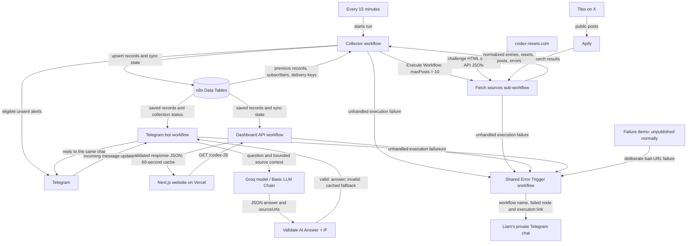

# Codex News architecture

Problem: Codex users repeatedly check Tibo's X posts to find improvements and usage resets. Codex News collects that information once, stores it, and makes it available through Telegram and a website.

Scope: Tibo (@thsottiaux), curated challenge announcements, confirmed resets, and the latest ten raw posts per collection. Deployment is n8n Cloud plus Vercel; Docker self-hosting is outside this version's agreed scope.

This is a service/workflow-level diagram. Each workflow contains its own node graph; those internal nodes are below this diagram's cut line.

## Stored state

- `codex28_announcements`: entries, resets and raw posts, keyed by record type and source ID.
- `codex28_sync_state`: collection time, status and coverage warnings.
- `codex28_subscribers`: chat ID, subscription state and alert preference.
- `codex28_deliveries`: delivery key, status and timestamps. Delivery logs use upsert so retries update a record instead of inserting another one.

Data Tables live inside the n8n Cloud project. They are persistent storage, distinct from the short-lived website cache. The project does not operate its own PostgreSQL server.

## Fetch contract

The Execute Workflow trigger explicitly declares a numeric `maxPosts` input. Collector sends `10`. Validate Fetch Inputs rejects missing values, strings, non-integers, and values outside 1–10 before external requests run. The source author is fixed. The sub-workflow returns entries, resets, updates, counts, fetchedAt, status, errors and an ok flag.

## AI contract and fallback

The model must return exactly `{"answer":"plain text","sourceUrls":["original URL"]}`.

Validate AI Answer parses JSON, checks the exact fields and their types, bounds answer length to 900 characters and URLs to two unique items, and requires every source URL to be an original Tibo URL present in the supplied context. It rejects URLs embedded in the answer body. The final reply is bounded to 1,400 characters and sent as plain text.

AI Answer Valid? sends accepted output to Send Answer and rejected output to Split Reply. Provider failures also go to Split Reply. That fallback is assembled from cached records by ordinary code. Schema and source checks do not establish that every sentence generated by a model is factually correct.

## Failure handling and retries

All external HTTP, database, Telegram, sub-workflow and model/chain nodes have Retry On Fail enabled with three total tries and a two-second wait. A request timeout does not prove that a remote action had no effect; Telegram and Apify retries can repeat an ambiguous request.

The four operating workflows point to the shared Error handler. It sends only workflow metadata and an execution URL to the agreed private chat, not raw exception bodies, message contents or keys. The handler has no error workflow linked to itself.

Handled degradation can still produce a successful execution: an unavailable optional source records a coverage warning; rejected AI output uses a fallback. Total collection-source failure records the status and reaches Stop Failed Collection, producing a failed execution and an error alert.

## Idempotency limits

Announcement upserts and saved delivery keys prevent normal repeated imports and already-sent alerts. This is not a transaction spanning n8n storage and Telegram: a successful send followed by failed logging can still be repeated. The bot treats two distinct incoming messages as two requests, even when their text matches.

## Freshness and limits

Collection runs every 15 minutes. Website server data and API caching use 60 seconds; visible pages refresh every minute and on returning to the tab. Curated announcements depend on codex-resets.com's own detection delay. Raw tweets collected by Apify do not decide broadcasts. A burst of more than ten posts between polls can leave recap gaps. Monthly provider quotas still apply.
